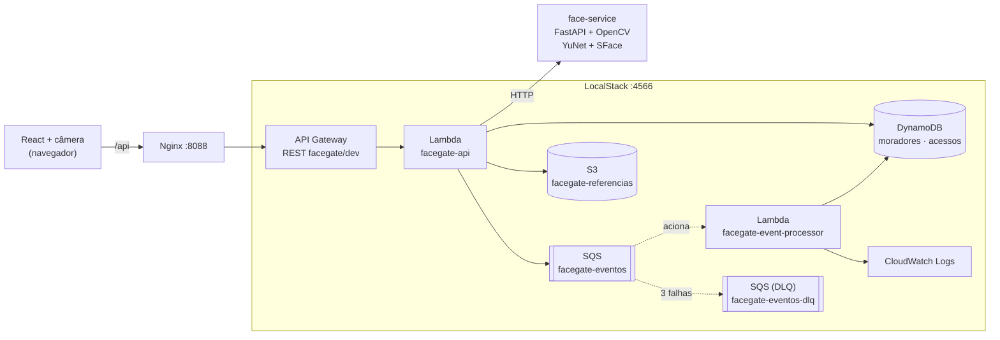
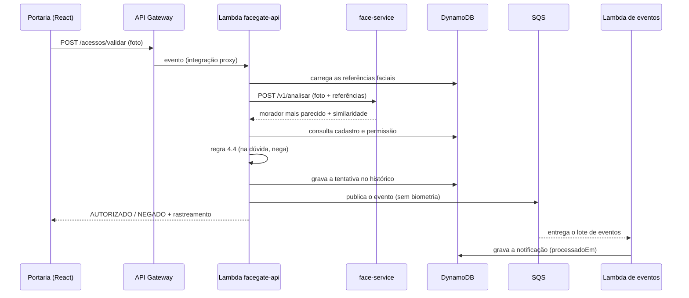

# FaceGate · Portaria Inteligente

Portaria com **reconhecimento facial** sobre uma arquitetura **serverless da AWS emulada no LocalStack**.
Projeto acadêmico de Computação em Nuvem (2026/2): API Gateway, Lambda, DynamoDB, S3 e SQS
rodando na máquina local com Docker, mais um serviço de visão computacional em Python (OpenCV).

> **Prova de conceito acadêmica.** O portão é simulado em software e o sistema **não deve
> controlar um portão real** (veja [Segurança, privacidade e limitações](#segurança-privacidade-e-limitações)).

---

## Sumário

1. [Como executar](#como-executar)
2. [Arquitetura](#arquitetura)
3. [Recursos do LocalStack usados](#recursos-do-localstack-usados)
4. [Roteiro para a apresentação](#roteiro-para-a-apresentação)
5. [Estrutura do projeto](#estrutura-do-projeto)
6. [API, dados e regras](#api-dados-e-regras)
7. [Testes](#testes)
8. [Comandos úteis](#comandos-úteis)
9. [Segurança, privacidade e limitações](#segurança-privacidade-e-limitações)
10. [Solução de problemas](#solução-de-problemas)

---

## Como executar

**Pré-requisito:** [Docker Desktop](https://www.docker.com/products/docker-desktop/) instalado e aberto.
Não é preciso instalar AWS CLI, Python nem Node.js.

```bash
docker compose up --build
```

Quando aparecer `[FaceGate] Infraestrutura pronta`, abra **<http://localhost:8088>**.

| Endereço | O que é |
|---|---|
| <http://localhost:8088> | Aplicação (Portaria, Moradores, Histórico e Infraestrutura) |
| <http://localhost:4566> | LocalStack: endpoint único de todos os serviços AWS |
| <http://localhost:8000/docs> | Documentação interativa do face-service (Swagger/FastAPI). A interface do Swagger é carregada da internet. |

- **Primeira execução:** leva alguns minutos para baixar as imagens (LocalStack, runtime das
  Lambdas e os modelos do OpenCV). Nas próximas, o ambiente fica pronto em cerca de 30 segundos.
- **Para parar:** `Ctrl + C` ou `docker compose down`.
- **Os dados não persistem.** A edição Community do LocalStack guarda tudo em memória:
  ao reiniciar, o ambiente volta vazio e o script recria a infraestrutura.

### Versão do LocalStack

Desde 23/03/2026, as versões novas do LocalStack (2026.x) exigem um *Auth Token* de conta.
O projeto usa por padrão a **4.14.0**, a última versão Community que roda **sem conta e sem
internet**, o que é ideal para apresentar. Para usar a versão atual, crie uma conta gratuita
(planos *Student* ou *Hobby*), copie `.env.example` para `.env` e preencha `LOCALSTACK_IMAGE` e
`LOCALSTACK_AUTH_TOKEN`. O sistema usa apenas recursos da edição Community e funciona nas duas.

---

## Arquitetura

A arquitetura segue a seção 3 do documento do projeto: apresentação, entrada, lógica de negócio,
reconhecimento facial e persistência.



| Componente | Responsabilidade |
|---|---|
| **React + câmera** (`web/`) | Captura a imagem, mostra a decisão e simula o portão. |
| **Nginx** (`web/nginx.conf`) | Serve o React e encaminha `/api` ao API Gateway, na mesma origem: sem CORS e sem depender de DNS externo. Na AWS, o CloudFront faria esse papel. |
| **API Gateway** (`infra/openapi.yaml`) | API REST com as rotas do projeto, importada de um contrato OpenAPI. |
| **Lambda `facegate-api`** (`lambdas/api/`) | Valida a entrada, chama o reconhecimento, **aplica as regras de autorização**, grava no DynamoDB/S3 e publica eventos no SQS. |
| **face-service** (`face-service/`) | Detecta o rosto (YuNet), gera a assinatura biométrica (SFace) e devolve a identidade provável com a similaridade. **Não decide** a autorização. |
| **DynamoDB** | Moradores (com a referência biométrica) e histórico de acessos. |
| **S3** | Fotos de referência do cadastro (bucket privado, criptografado). |
| **SQS + Lambda `facegate-event-processor`** (`lambdas/event_processor/`) | Processa notificações fora do caminho da resposta, com fila de mensagens mortas (DLQ). |

### Fluxo de uma solicitação de entrada (seção 4.2)



A Portaria mostra esse caminho ao vivo: cada etapa aparece com o serviço AWS e o tempo gasto.

---

## Recursos do LocalStack usados

O objetivo do trabalho é o LocalStack, então o projeto aproveita os recursos próprios dele e
ajusta a configuração para desempenho:

| Recurso | Onde | Para quê |
|---|---|---|
| **Init hooks** (`/etc/localstack/init/ready.d`) | `localstack/init/ready.d/provisionar.sh` | Cria **toda** a infraestrutura sozinho quando o LocalStack fica pronto. |
| **`awslocal`** | Script e demonstração | AWS CLI já apontada para o LocalStack, dentro do próprio contêiner. |
| **`/_localstack/init/ready`** | Healthcheck do `docker-compose.yml` | O frontend só sobe depois que o provisionamento terminou com sucesso. |
| **`/_localstack/health`** | Tela Infraestrutura e barra lateral | Versão, edição e estado de cada serviço emulado. |
| **Tag `_custom_id_`** | API Gateway | ID fixo `facegate`, para que a URL da API não mude a cada execução. |
| **`/_aws/execute-api/{id}/{stage}`** | Nginx e Vite | Chama o API Gateway sem precisar do DNS `localhost.localstack.cloud`, então funciona **offline**. |
| **`AWS_ENDPOINT_URL` injetado nas Lambdas** | `lambdas/api/repositorio.py` | O boto3 encontra o LocalStack sozinho: **o código é o mesmo da AWS real**. |
| **`LAMBDA_DOCKER_NETWORK`** | `docker-compose.yml` | As Lambdas (contêineres criados pelo LocalStack) alcançam o face-service pelo nome. |
| **`SERVICES` + `EAGER_SERVICE_LOADING`** | `docker-compose.yml` | Carrega só os 8 serviços usados, já no boot: a primeira chamada não espera nada subir. |
| **`DYNAMODB_IN_MEMORY`** | `docker-compose.yml` | DynamoDB em memória, sem I/O de disco. |
| **`LAMBDA_KEEPALIVE_MS=3600000`** | `docker-compose.yml` | Mantém as Lambdas aquecidas por 1 h: sem *cold start* durante a apresentação. |
| **`LAMBDA_EVENT_SOURCE_MAPPING_MAX_BACKOFF_ON_EMPTY_POLL_SEC=1`** | `docker-compose.yml` | Com a fila vazia, o LocalStack espaça as consultas ao SQS em até 10 s. Limitando a 1 s, as notificações saem quase na hora. Esse ajuste veio da leitura do código-fonte do LocalStack. |
| **Aquecimento** | Fim do `provisionar.sh` | A primeira invocação baixa o runtime e sobe os contêineres das Lambdas antes do primeiro uso. |

**Números medidos** neste projeto (Windows 11, Docker Desktop, 8 CPUs):

| Medida | Resultado |
|---|---|
| Provisionamento completo (IAM, S3, DynamoDB, SQS, Lambdas, API Gateway) | 22 a 29 s |
| Requisição aquecida API Gateway → Lambda → DynamoDB | ~30 ms |
| Reconhecimento facial no face-service (imagem de até 960 px) | 50 a 130 ms |
| Solicitação de acesso completa, medida no navegador | 150 a 220 ms |
| Fila SQS → Lambda de eventos → DynamoDB | 0,3 a 0,9 s (antes do ajuste: até 10 s) |

---

## Roteiro para a apresentação

Antes de começar, rode `docker compose up --build`, abra <http://localhost:8088> e deixe um
terminal aberto na pasta do projeto.

| # | O que mostrar | Como |
|---|---|---|
| 1 | **Infraestrutura como código** | `docker compose logs localstack` e procure as linhas `[FaceGate]`: o init hook criando IAM, S3, DynamoDB, SQS, Lambdas e API Gateway. |
| 2 | **Serviços no ar** | Tela **Infraestrutura**: diagrama da seção 3 com o estado de cada serviço ao vivo. |
| 3 | **Cadastro** (seção 4.1) | **Moradores → Novo morador**: foto, consentimento e cadastrar. No terminal: `docker exec facegate-localstack awslocal s3 ls s3://facegate-referencias/moradores/` |
| 4 | **Pessoa autorizada** (8.1) | **Portaria → Solicitar acesso**: o portão abre. Mostre o *caminho da requisição* com o tempo de cada serviço. |
| 5 | **Processamento assíncrono** (4.3) | **Histórico**: a notificação muda de "Na fila" para "Processada em 0,x s" (SQS → Lambda de eventos). |
| 6 | **Pessoa não cadastrada** (8.1) | Outra pessoa na Portaria: acesso negado e alerta à administração. |
| 7 | **Cadastro inativo** (8.1) | Desative o morador em **Moradores**: na Portaria ele é *reconhecido*, mas *negado*. |
| 8 | **Falha de serviço** (8.1) | `docker compose stop face-service`, depois Portaria: negado por segurança (*fail-closed*). Volte com `docker compose start face-service`. |
| 9 | **Logs (CloudWatch)** | Copie o comando de logs na tela **Infraestrutura**: as notificações geradas pela Lambda de eventos. |
| 10 | **Exclusão (LGPD)** | Exclua o morador: cadastro, foto (S3) e biometria (DynamoDB) somem. Repita o `s3 ls`. |

> **Dica:** o atalho **barra de espaço** solicita o acesso na Portaria. Sem webcam, use
> **"Usar uma foto"**.

---

## Estrutura do projeto

```
FaceGate/
├── docker-compose.yml           # sobe tudo: LocalStack, face-service e web
├── .env.example                 # versão do LocalStack, porta e limiar facial
├── localstack/init/ready.d/
│   └── provisionar.sh           # init hook: cria a infraestrutura AWS com awslocal
├── infra/
│   ├── openapi.yaml             # contrato da API importado no API Gateway
│   └── iam/                     # papéis e políticas de privilégio mínimo das Lambdas
├── lambdas/
│   ├── api/                     # Lambda facegate-api
│   │   ├── handler.py           #   rotas HTTP e respostas
│   │   ├── regras.py            #   regras de negócio puras (decisão de acesso)
│   │   ├── biometria.py         #   cliente HTTP do face-service
│   │   └── repositorio.py       #   DynamoDB, S3 e SQS
│   └── event_processor/         # Lambda facegate-event-processor (consumidora do SQS)
├── face-service/                # FastAPI + OpenCV (YuNet + SFace)
├── web/                         # React + TypeScript + Vite, servido pelo Nginx
└── tests/
    ├── unit/                    # regras, notificações e biometria (sem Docker)
    └── e2e/                     # cenários da seção 8.1 contra o sistema real
```

As Lambdas usam **apenas a biblioteca padrão e o boto3** que já vem no runtime `python3.13`.
O pacote tem poucos KB e é gerado pelo próprio script de provisionamento. Depois de editar uma
Lambda, publique o código novo sem reiniciar nada:

```bash
docker compose exec localstack bash /etc/localstack/init/ready.d/provisionar.sh
```

---

## API, dados e regras

### Rotas (API Gateway → Lambda `facegate-api`)

| Método | Rota | Operação |
|---|---|---|
| `POST` | `/moradores` | Cadastra o morador e a referência facial (exige consentimento). |
| `GET` | `/moradores` | Lista os moradores, **sem dados biométricos**, com a URL temporária da foto. |
| `GET` | `/moradores/{id}` | Consulta um morador. |
| `PATCH` | `/moradores/{id}` | Atualiza nome, unidade ou status (ativar/desativar). |
| `DELETE` | `/moradores/{id}` | Exclusão definitiva: cadastro, foto e biometria (LGPD). |
| `POST` | `/acessos/validar` | Identifica a pessoa e devolve a decisão e o rastreamento. |
| `GET` | `/acessos?dia=AAAA-MM-DD` | Histórico de um dia (padrão: hoje). |
| `GET` | `/sistema` | Resumo da infraestrutura (painel). |

Pela aplicação, todas as rotas ficam em `http://localhost:8088/api/...`. Direto no LocalStack, em
`http://localhost:4566/_aws/execute-api/facegate/dev/...`.

### Modelo de dados (DynamoDB)

| Tabela | Chaves | Atributos |
|---|---|---|
| `facegate-moradores` | PK `moradorId` | `nome`, `unidade`, `status` (ATIVO/INATIVO), `faceRef` (assinatura SFace, 128 números em base64), `fotoKey`, `consentimentoEm`, `criadoEm`, `atualizadoEm` |
| `facegate-acessos` | PK `dia` + SK `dataHora` | `acessoId`, `moradorId`, `nome`, `unidade`, `resultado`, `motivo`, `similaridade`, `notificacao`, `processadoEm`, `expiraEm` (TTL) |

A tabela de acessos usa o **dia como chave de partição e o horário como chave de ordenação**.
Assim, o histórico de um dia sai com uma *Query*, já em ordem cronológica, sem varrer a
tabela inteira com *Scan*.

### Regra de autorização (seção 4.4)

Reconhecer a pessoa **não** equivale a autorizá-la. A Lambda (`lambdas/api/regras.py`) só
autoriza quando **todas** as condições são verdadeiras:

1. exatamente **um rosto válido** foi detectado;
2. a **similaridade** superou o limiar configurado;
3. o morador existe e está **ATIVO**;
4. **nenhuma consulta falhou**.

Na dúvida ou em caso de falha, o resultado é **NEGADO**, inclusive no navegador. Os motivos
possíveis são `RECONHECIDO`, `NAO_RECONHECIDO`, `CADASTRO_INATIVO`, `NENHUM_ROSTO`,
`MULTIPLOS_ROSTOS`, `ROSTO_DISTANTE`, `IMAGEM_INVALIDA` e `FALHA_SERVICO`.

**Limiar configurado e testado:** o padrão é **0,363**, o valor de referência publicado pelo
OpenCV para o SFace (variável `LIMIAR_SIMILARIDADE` no `.env`). Nos testes com retratos de
domínio público, fotos da **mesma pessoa tiradas com 8 anos de diferença** tiveram similaridade
**0,76**, e **pessoas diferentes** ficaram entre **0,08 e 0,11**: há folga dos dois lados do limiar.

---

## Testes

```bash
# Uma vez: cria o ambiente Python local (o VS Code também passa a reconhecer os imports)
uv venv .venv --python 3.13 && uv pip install -r requirements-dev.txt
#   sem o uv: python -m venv .venv  e depois  .venv\Scripts\pip install -r requirements-dev.txt

.venv\Scripts\pytest tests/unit    # regras de decisão, notificações e biometria (rápidos, sem Docker)
.venv\Scripts\pytest tests/e2e     # cenários da seção 8.1 contra o sistema no ar (docker compose up)
```

Para o editor reconhecer os tipos do frontend (React, Vite), instale também as dependências em
`web/`: `cd web && npm ci`. O `.vscode/settings.json` já aponta o VS Code para o `.venv` e para
as pastas das Lambdas.

- **Unitários (47):** regra 4.4, validações, montagem das notificações e funções puras da biometria.
- **Ponta a ponta (12):** infraestrutura integrada, imagem sem rosto negada e processada pela fila,
  entradas inválidas e os cenários com rosto da seção 8.1. Esses últimos usam fotos de voluntários em
  `tests/e2e/fotos/` (veja o [LEIA-ME](tests/e2e/fotos/LEIA-ME.md)) e são pulados se não houver fotos.
- **Qualidade:** `ruff check .` (Python). No frontend, o `npm run build` faz a checagem de tipos
  (TypeScript) e o `npm run lint` roda o oxlint, com as regras de hooks e de acessibilidade.

---

## Comandos úteis

Todos usam o `awslocal` que já existe dentro do contêiner do LocalStack:

```bash
# Rotas criadas no API Gateway
docker exec facegate-localstack awslocal apigateway get-resources --rest-api-id facegate --query "items[].path"

# Funções Lambda
docker exec facegate-localstack awslocal lambda list-functions --query "Functions[].[FunctionName,Runtime,Timeout]" --output table

# Histórico de acessos no DynamoDB
docker exec facegate-localstack awslocal dynamodb scan --table-name facegate-acessos --max-items 3

# Fotos de referência no S3
docker exec facegate-localstack awslocal s3 ls s3://facegate-referencias/moradores/

# Notificações geradas pela Lambda de eventos (CloudWatch Logs)
docker exec facegate-localstack awslocal logs filter-log-events --log-group-name /aws/lambda/facegate-event-processor --filter-pattern NOTIFICACAO_ENVIADA --query "events[].message" --output text

# Filas SQS
docker exec facegate-localstack awslocal sqs list-queues
```

---

## Segurança, privacidade e limitações

Dados faciais são **dados pessoais sensíveis** (LGPD, art. 11). Medidas adotadas:

- **Consentimento obrigatório** no cadastro, registrado em `consentimentoEm`.
- **Minimização:** as capturas da portaria são analisadas em memória e **descartadas**. Só a foto
  do cadastro é guardada.
- **Biometria nunca sai do backend:** a referência facial não aparece nas respostas da API, nos
  logs nem nas mensagens da fila.
- **Acesso restrito às fotos:** bucket privado, com bloqueio de acesso público e criptografia
  (SSE). As fotos são exibidas por **URL pré-assinada** que expira em 15 minutos.
- **Exclusão:** `DELETE /moradores/{id}` apaga o cadastro, a foto e a biometria.
- **Retenção:** cada registro de acesso expira em 90 dias (TTL do DynamoDB).
- **Privilégio mínimo:** cada Lambda tem um papel IAM com só as permissões de que precisa
  (`infra/iam/`). O LocalStack Community não aplica IAM, mas as políticas estão prontas para a AWS.
- **Exposição local:** as portas abrem apenas em `localhost`, nunca na rede.

Limitações conhecidas:

- **Não controla um portão real:** não há prova de vivacidade (uma foto impressa pode enganar o
  sistema) nem mecanismo físico de segurança.
- O reconhecimento facial está sujeito a **erros e vieses**. O limiar é um compromisso entre falsos
  aceites e falsas recusas.
- **Sem autenticação no painel administrativo:** o protótipo é de uso local. Em produção, entraria
  um provedor de identidade (por exemplo, Amazon Cognito).
- O LocalStack reproduz **parte** do comportamento da AWS: a validação local não substitui testes
  na nuvem.
- Em **produção na AWS**, o face-service rodaria em ECS/Fargate (ou como Lambda em contêiner) e
  `S3_ENDPOINT_PUBLICO` seria removido. O restante do código não muda.

---

## Solução de problemas

| Sintoma | Solução |
|---|---|
| `Cannot connect to the Docker daemon` | Abra o Docker Desktop e aguarde ele iniciar. |
| `ports are not available` / porta em uso | Outro programa usa a porta. Defina outra em `.env` (`FACEGATE_PORTA=8090`). Para a 4566, pare outro LocalStack que esteja rodando. |
| Erro ao publicar `[::1]` (IPv6 desativado) | Remova as linhas `"[::1]:..."` do `docker-compose.yml`. |
| `localstack` sai com código **55** | Você está usando uma imagem 2026.x sem token: use a 4.14.0 (padrão) ou configure `LOCALSTACK_AUTH_TOKEN`. |
| Provisionamento falha com `$'\r': command not found` | O `provisionar.sh` ficou com quebras de linha do Windows (CRLF). O `.gitattributes` evita isso ao clonar. Para corrigir, no VS Code clique em "CRLF" no canto inferior direito, escolha "LF", salve e rode `docker compose restart localstack`. |
| A câmera não abre | Permita a câmera no ícone da barra de endereço. Acesse por `http://localhost` (navegadores só liberam câmera em `localhost` ou HTTPS). Sem webcam, use **"Usar uma foto"**. |
| "Nenhum rosto detectado" | Rosto de frente, bem iluminado, dentro da moldura e sem boné ou óculos escuros. |
| A primeira execução demora | É o download das imagens e dos modelos. Acompanhe com `docker compose logs -f localstack`. |
| Os moradores sumiram | A edição Community não persiste dados entre reinícios. Cadastre de novo. |
| Projeto dentro do OneDrive | Para **rodar** o sistema basta o Docker. As dependências locais do editor (`.venv` com ~230 MB e `web/node_modules` com ~145 MB) seriam sincronizadas pelo OneDrive. Prefira uma pasta fora dele, por exemplo `C:\dev\FaceGate`. |
| VS Code acusa imports ou tipos não encontrados | Crie o `.venv` e rode `npm ci` em `web/` (veja [Testes](#testes)). Depois use "Python: Select Interpreter" → `.venv`. |

### Desenvolvimento do frontend (opcional)

Com o ambiente no ar, rode o React com recarga automática (precisa de Node.js 24):

```bash
cd web
npm install
npm run dev        # http://localhost:5173 (o Vite repassa /api ao LocalStack)
```

---

**Equipe:** Lucas Costa · Cauã Evaristo · Murillo Lessa · Eduardo Sahaidak.
**Professor:** Fábio Castro. **Disciplina:** Computação em Nuvem, 2026/2, Palmas-TO.
